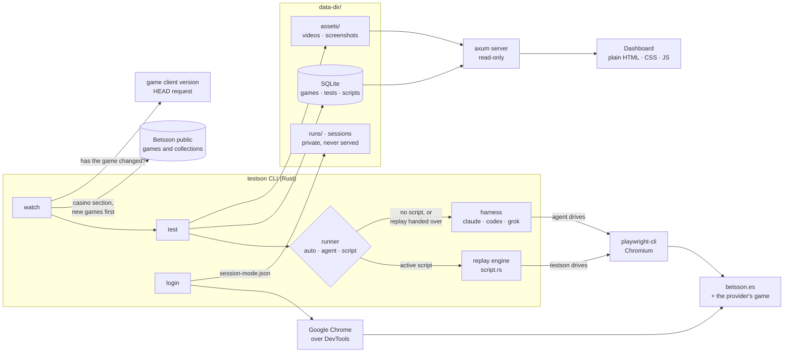

# testson

**An AI agent tests every casino game with real money once per version, then hands the job to a
replay script that runs with no model at all.**

testson tests every game in the casino section of Betsson, from every provider (about 2,150 games
from 12 providers today), with two real accounts:

| Mode         | Account        | `working` means                                                                                                                                            |
| ------------ | -------------- | ---------------------------------------------------------------------------------------------------------------------------------------------------------- |
| `real-money` | Has balance    | One spin at the minimum stake settles, and both the Betsson balance and the balance inside the game change by the stake and the win, to the cent, in euros |
| `no-balance` | Has no balance | Trying to bet shows an "insufficient funds" message in Spanish, no round is played, and neither balance changes                                            |

An AI coding agent (Claude Code, Codex or Grok) drives a real browser through `playwright-cli`. While it tests, it writes the
commands that worked as a **replay script**. testson replays that script itself until the game's
version changes. Every test is stored in SQLite with its steps, screenshots, video, console log,
failed requests and game `postMessage`s, and a local dashboard shows the whole catalogue,
filtered by provider and by status.

> Pay for intelligence once per game version; run the regression for free.

## Architecture



The CLI writes to SQLite and the axum server only reads from it, so the two can run side by side.
**Life of a test** (one game, one mode):

1. **Is there an active script for this game and mode?** If not, go to step 4.
2. **Replay, with no model.** Read the balance and check the account is the right one for the
   mode, then open the game, fill in the gaming session and read the stake. **At the spin**,
   check that the file of the game client the browser loaded has the script's version, and that
   the stake is above 0, at most 1 € and within the balance (above it, with no balance). Then
   press once.
3. **Replay outcome:**
   - **Every step ran:** `working`. The Betsson balance and the balance inside the game are
     checked apart. With real money, it is `failing` if either balance before, less the stake,
     plus the win, isn't the balance after, to the cent. If the win couldn't be read, it checks
     only that each lost no more than the stake. With no balance, it is `failing` if either
     changed or the message isn't in Spanish. In both modes, it is `failing` if the currency
     isn't the euro.
   - **A step broke, or the version changed, before the spin:** stored as `test_failed`, the
     script is retired, and the agent takes over (step 4).
   - **A step broke after the spin:** stored as `test_failed` and the script is retired. A round
     was already played, so the agent waits for the next test.
   - **Blocked** (wrong account, stake out of bounds, no login): stored as `test_failed`. The
     script is kept and no agent runs.
4. **Agent run.** A one-word ping checks that the CLI and model answer; if it fails, the command
   stops. The agent then gets up to 20 minutes. Its `report.json` is validated against
   `schema/test-game.schema.json`. A missing or invalid report is stored as `test_failed`.
5. **A clean exit, `working`, and a valid `script.json`** that matches the version: the script is
   stored and **replayed at once** as a test of its own (a second real-money round).

## Codebase explained

Roughly 7,800 lines of Rust and 75 unit tests, shipped as **a single binary**: pages, prompts,
schemas and migrations are compiled in. The dashboard has no build step and no dependencies.

| Path                              | Responsibility                                                                                                                           |
| --------------------------------- | ---------------------------------------------------------------------------------------------------------------------------------------- |
| `src/main.rs`                     | CLI (`serve`, `test`, `watch`, `sync`, `login`, `ping`, `check-script`) and server start-up                                              |
| `src/run.rs`                      | One test in one mode: run directories, agent vs. replay, fallback, storing                                                               |
| `src/script.rs`                   | Replay-script safety rules (`script::validate`) and the replay engine                                                                    |
| `src/watch.rs`                    | The catalogue loop: what needs testing, retry budget, single-watch lock                                                                  |
| `src/harness.rs`, `src/events.rs` | Agent CLIs, model/effort, the ping; live progress and cost from event streams                                                            |
| `src/prompt.rs`, `prompts/`       | Prompt filling and URL checks; the prompt, per-mode rules, `postMessage` capture                                                         |
| `schema/*.json`, `src/report.rs`  | JSON Schemas of a test and a script (also in the prompt); report validation                                                              |
| `src/login.rs`, `scripts/`        | Agent-free login in real Chrome                                                                                                          |
| `src/catalog.rs`                  | Public games catalogue and game collections (the casino section, the new games) behind a `Fetcher` trait, so tests never hit the network |
| `src/db.rs`, `migrations/`        | Every SQL query, grouped by table; numbered migrations via `user_version`                                                                |
| `src/router.rs`, `web/`           | JSON API, pages and served evidence                                                                                                      |

Principles: a test is **one JSON document**, and its `status`, `mode`, `runner` and version columns
are _generated_ by SQLite from it, so they can't drift. The schema is the contract for the prompt,
the Rust types and validation alike. Clippy `pedantic` is denied and `unsafe` is forbidden. Unit
tests never call an agent or the live site. Rules for contributors are in [`AGENTS.md`](AGENTS.md).

## Main features and decisions

**1. The agent explores, the script repeats.** Working out an unfamiliar game UI is costly, so the
LLM does it once per version and mode. After that, a replay costs **zero tokens**. Screens that
come and go, such as session notices, the gaming-session form, cookie banners and welcome
dialogs, are marked `optional`, so a replay skips them instead of breaking. Before it finishes,
the agent runs `testson check-script` on its own script, so it can fix whatever a replay would
refuse.

**2. Every provider, new games first.** The games come from Betsson's public API: those of the
`Casino` collection, the casino section of the lobby, so the live casino, the jackpots lobby and
the sportsbook stay out. Its `NewGames` collection ("Novedades") is Betsson's list of new games:
`watch` tests the games new to the dashboard first, then those, in Betsson's order, and
`watch --new-games` tests only those. The prompt tells the agent the provider and the type of the
game, and what "spin" means in a table game or a scratch card.

**3. Change detection with one `HEAD` request.** A game's version is that of one file of its
client that changes with each release and keeps its URL: the `build.js` of Pragmatic Play, or the
main script or page of another provider's client, which the agent picks. The version is the
file's ETag (weak `W/"…"` and strong forms count as equal) or, when its server sends none, its
Last-Modified date. `watch` checks it with no browser and no login, and retests a game only when it
changed. The replay checks the version again, finding the file by its path, just before it bets.

**4. Real money, with layered guardrails.** Demo mode skips the wallet, the very part worth
testing. So safety is layered:

| Layer         | Guardrail                                                                                                                                                                                                                                                                                                                                                                                                                                                                                                                      |
| ------------- | ------------------------------------------------------------------------------------------------------------------------------------------------------------------------------------------------------------------------------------------------------------------------------------------------------------------------------------------------------------------------------------------------------------------------------------------------------------------------------------------------------------------------------ |
| Prompt        | Never demo, cashier, deposit, withdrawal, autoplay, bonus buy, ante bet or gamble. One press of spin, at the minimum stake, never above 1 € or the balance. The no-balance test never bets when the account has 0.10 € or more                                                                                                                                                                                                                                                                                                 |
| Operator      | When Betsson asks for the gaming session Spanish rules require, testson sets 15 minutes and a **10 € loss limit** (the largest amount below it if the form refuses 10 €). Betsson enforces it                                                                                                                                                                                                                                                                                                                                  |
| Validator     | Before every replay, each model-written script is checked. Page commands only, with no `run-code` and no `eval` that acts. At most one spin, nothing done after it. The balance is read before any action, and the stake right before the spin. Navigation stays on Betsson. No number above 10 is typed, and `type` never types a space, which would press Space and spin. No argument names the cashier, deposits, withdrawals, demo play, bonuses, buy features, autoplay or gamble, and no `eval` reads cookies or storage |
| Runtime       | The replay stops on the wrong account. At the spin, it also stops if the version changed or the stake is out of bounds. With no balance, it presses only when the stake is above both balances, so no round can be played                                                                                                                                                                                                                                                                                                      |
| Orchestration | After a replay has spun, the agent isn't called in the same test. At most 3 attempts per game, mode and version                                                                                                                                                                                                                                                                                                                                                                                                                |

**5. Credentials never reach a model.** The login runs scripts with `playwright-cli`, with no
agent. Credentials are passed as `playwright-cli` secrets through a temporary file that is deleted
before the first step, so no output or log holds them. The agent only loads the saved session by
its path. Only videos and images under `data-dir/assets/` are served, on `127.0.0.1`. Sessions,
traces and credentials stay private. Tokens are redacted from captured messages.

**6. Auditable evidence.** Each test has numbered steps with screenshots, a video, console
messages, failed requests and `postMessage`s. The games page filters by provider, with a toggle
at the top, and by status, and each keeps its choice while the other changes. The game page shows
who ran each test (**AI** or **Script**), the version it saw, and a timeline of new versions,
scripts and status changes. The Stats page shows each game's latest 30 tests as a status bar with
an uptime.

**7. Model-agnostic.** `--harness claude|codex|grok`, with `--model` and `--effort`.

### Cost model

| Measured (fill in from real runs) | Agent   | Replay |
| --------------------------------- | ------- | ------ |
| Median duration                   | 8 min   | 3 min  |
| Model cost per run                | $ 0.015 | $0     |

Durations are stored as `duration_ms` on each test. Each run's cost is in
`data-dir/runs/<run>/model.log`, and `test` prints the total.

## Our design is not perfect

| Limitation today                                                                                                                                                                                           | Next step                                                                                             |
| ---------------------------------------------------------------------------------------------------------------------------------------------------------------------------------------------------------- | ----------------------------------------------------------------------------------------------------- |
| It spends **real money**, bounded but real                                                                                                                                                                 | Operator test wallets or a provider staging RGS                                                       |
| **Sequential**: one browser, and the modes run one after the other. A first full pass of the casino takes days                                                                                             | A worker pool with an account pool                                                                    |
| The version is **one file's ETag or date**, so other asset or server-side changes go unseen. A release that renames that file stops the replay as a broken step, and the agent tests it                    | Fingerprint the asset manifest and game config, plus periodic replays                                 |
| The **first verdict is an LLM's**                                                                                                                                                                          | More deterministic checks (`postMessage` contracts), a second-model review of `failing`, human triage |
| The **login fights a fraud check**, and a captcha or SMS code needs a person                                                                                                                               | Official QA accounts or an operator API                                                               |
| **Hard-wired scope**: one operator, Spanish rules, two modes                                                                                                                                               | Pluggable operators, providers and jurisdictions; the mode prompts and `Fetcher` trait are the seams  |
| **Local only**: SQLite, `127.0.0.1`, no auth                                                                                                                                                               | A hosted, multi-tenant service with Postgres                                                          |
| Model cost is **logged but not stored** per test, and Codex reports none                                                                                                                                   | Store tokens and cost per test, with budget caps                                                      |
| **No alerting**                                                                                                                                                                                            | Webhooks or Slack on `working → failing`                                                              |
| A game that needs **a decision after the bet**, such as standing in blackjack or revealing a scratch card, can't be replayed, since nothing may act after the spin, so the agent tests every version of it | Allow a short list of decisions that bet nothing after the spin                                       |

**Vision:** a continuous compliance monitor for any operator's catalogue. Every game, on every
release, in every jurisdiction, verified within minutes of the provider shipping it, at a marginal
cost close to zero, with evidence a compliance officer can audit. The hard parts already work: the
hand-off from agent to deterministic script, change detection, safety validation and evidence.
What's left is mostly scale and integration.

## How to use

**Requirements:** Rust 1.89+, Node.js 20+, Google Chrome (for login only), and, for agent runs,
`claude` (default), `codex` or `grok`, logged in.

```sh
cargo build --release
npm install -g @playwright/cli@0.1.22      # exactly this version: the prompt targets its commands
playwright-cli install-browser chromium
```

**1. Dashboard** (needs no account): run `cargo run -- serve` and open <http://127.0.0.1:8000>.
`cargo run -- sync` lists every game of the casino section on it without testing any.

> ⚠️ The steps below **spend real money** (one minimum stake per real-money test) and **model
> tokens**. Use dedicated test accounts.

**2. Accounts.** Create `data-dir/credentials-real-money.env` and
`data-dir/credentials-no-balance.env`:

```sh
BETSSON_USERNAME=user@example.com
BETSSON_PASSWORD=the password
```

Then run `cargo run -- login` (or `--mode no-balance`). It logs in to each account in Chrome and
saves `data-dir/session-<mode>.json`. If a captcha or SMS code appears, finish it in the window;
testson waits up to 5 minutes. The `.env` files stay (mode 0600), so `watch` can log in again when
a session expires. You can also log in through your own Chrome started with
`--remote-debugging-port=9222 --disable-blink-features=AutomationControlled`, then pass
`--mode <mode> --cdp http://127.0.0.1:9222`.

**3. Test one game:**

```sh
cargo run -- ping                                   # does the agent CLI and model answer?
# One of the following:
cargo run -- test "Big Bass Blast"                  # both modes
cargo run -- test "Big Bass Blast" --mode no-balance
cargo run -- test "Big Bass Blast" --runner agent   # auto (default) | agent | script
cargo run -- test "Big Bass Blast" --harness codex --model gpt-5.5
```

It prints each test's runner, status, summary, video and dashboard link, then the total time and
model cost. The exit code is 0 only if every mode is `working`.

**4. Watch the catalogue:**

```sh
cargo run -- watch --list          # list only, Betsson's new games first: no login, no spending
cargo run -- watch --limit 1       # at most 1 game per check, new games first
cargo run -- watch --new-games     # only the games Betsson lists as new ("Novedades")
cargo run -- watch --every 30m     # repeat (minimum 60 s); one watch per data directory
```

The first pass tests every game of the casino section in both modes: first those new to the
dashboard, then those Betsson lists as new, in its order, then the rest by name. Later checks
retest only games whose version changed, and retry a `test_failed` up to 3 times per mode and
version.

**Statuses.** `working` means the game behaved as the mode expects. `failing` means it didn't
launch, the round broke, the balance was wrong, or no message appeared. `test_failed` means the
test itself broke (an expired session, the wrong account, controls it couldn't read) and says
nothing about the game.

**Options.** Every command takes `--data-dir` (default `data-dir/`). Most flags also have an
environment variable: `TESTSON_DATA_DIR`, `TESTSON_RUNNER`, `TESTSON_HARNESS`, `TESTSON_MODEL`,
`TESTSON_EFFORT` and `TESTSON_CHROME`. With `claude` the default model is `sonnet` and the default
effort `medium`; `codex` and `grok` use their own configured model.

## Team

- Sergio Castaño Sánchez
- Daniel Castaño Sánchez
- Álvaro Reinoso Alvarado
- María Victoria Maldonado Bao
